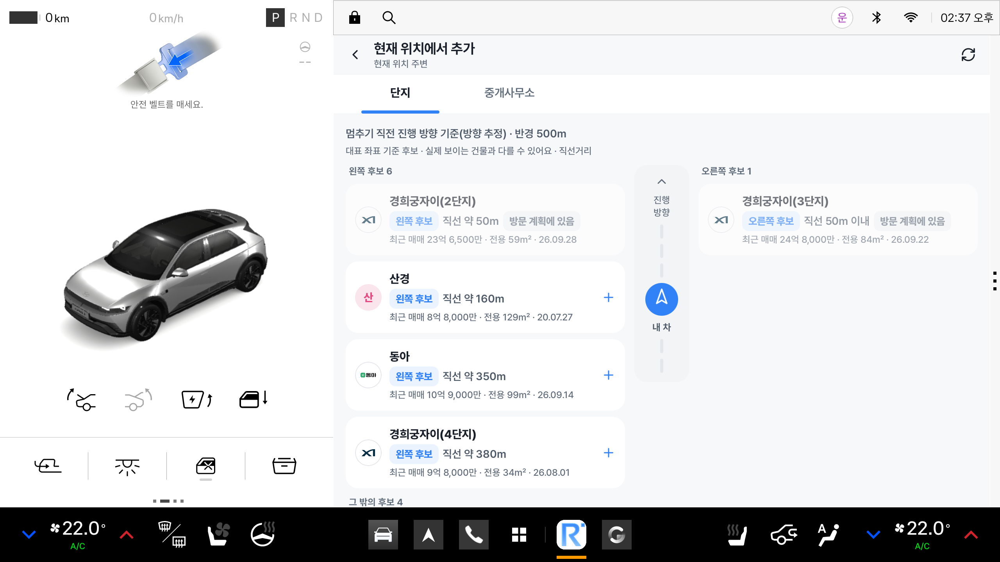
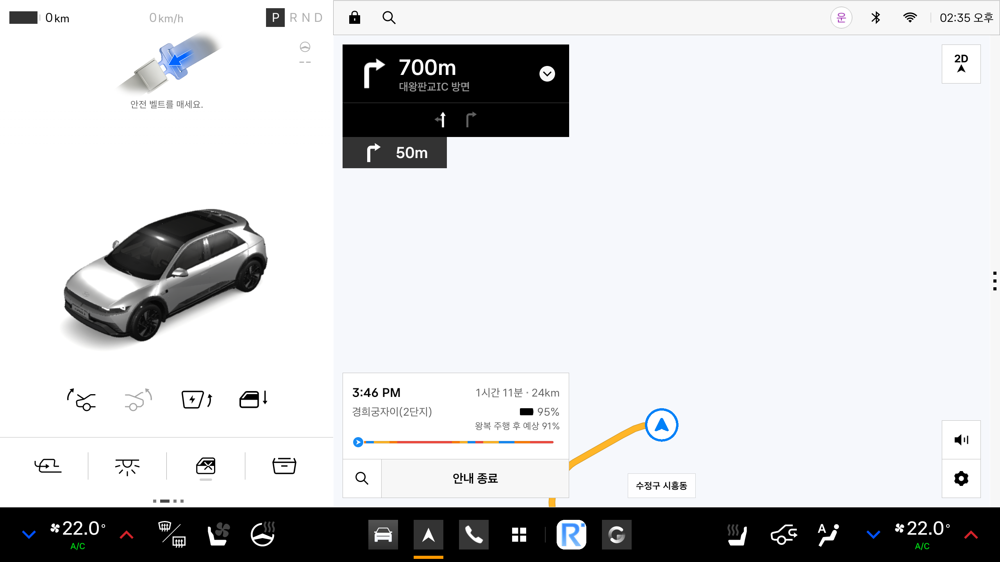

# REEVL for Pleos

**지나가는 동네가 궁금해질 때, 리블.**

Pleos Connect 차량용 앱입니다. 차량의 위치와 진행 방향으로 주변 아파트 단지 후보(왼쪽·오른쪽·앞)를 찾고, 실거래 근거를 보여 줍니다. 마음에 든 단지는 방문 계획에 넣고 Pleos 기본 내비게이션으로 안내합니다.
데이터는 운영 중인 부동산 데이터 서비스 [리블](https://reevl.co.kr)(전국 아파트 단지·국토교통부 실거래가 기반)에서 옵니다.

현대자동차그룹 차량용 앱 개발 공모전(Pleos App Market) 출품작입니다. 현대자동차그룹·42dot과의 공식 제휴를 뜻하지 않습니다.

| 주변 단지 좌우 후보 (정차 중) | NaviHelper로 기본 내비에 목적지 전달 |
|---|---|
|  |  |

> 화면은 Pleos Connect Emulator v2.1.0에서 찍었습니다. 단지·거래 값은 리블 실데이터, 차량 위치는 에뮬레이터 좌표입니다.

## 지금 동작하는 것 (에뮬레이터 실측)

| 기능 | 상태 |
|---|---|
| Pleos **NaviHelper 3.0.5**로 목적지 전달 | 동작. 요청한 좌표와 `getDestinationInfo()`가 1e-5 안에서 일치할 때만 성공으로 처리 |
| 주행 제한 (`CarUxRestrictions`) | 동작. Virtual Console의 기어·속도 신호로 주행 중 상세 화면·편집 차단 |
| 주변 단지 좌·우·앞 후보 | 동작. `bearing(차→단지) − heading`을 ±35°/145° 기준으로 분류, 방향을 모르면 `unknown` |
| 방문 계획 불러오기·현장에서 단지 끼워 넣기·되돌리기 | 동작 (리블 서버 연동) |
| 차량 연결 (6자리 일회용 코드 → 차량 토큰) | 동작. 토큰은 AndroidKeyStore AES-GCM으로 암호화 저장, 로그에 남기지 않음 |
| 오프라인 | 캐시 표시 + `마지막 동기화 HH:MM` |

## 개발 중 (11/15 제출 · 12/3 시연 목표)

- 리블 AI 자연어 조건 검색 ("8억 이하로 거래된 1천 세대 넘는 곳") — 조건 해석은 모델·규칙이, 진위 판정은 DB가 한다
- 관심 단지 저장과 웹 동기화, 최근 지나온 후보 다시 보기
- Gleo App Schema 함수 3개(`SEARCH_PROPERTIES`·`ANALYZE_PROPERTY`·`MANAGE_VISIT_PLAN`) — **등록·승인 전이라 연동 구상 단계**
- release APK (`apk/`)

## 구조

```
app/src/main/java/kr/co/reevl/ontheway/
  navi/      NaviAdapter (차량 내비로 가는 유일한 문) · PleosNaviAdapter · MockNaviAdapter · CoordsGate
  nearby/    NearbyEngine (좌우 판정, 순수 로직) · CarLocation
  car/       CarUxGate (주행 제한)
  plan/      방문 계획 순서·삽입·결과 판정
  data/      리블 차량 API 클라이언트 · KeyStore 토큰 저장
  ui/        Compose 화면 (리블 디자인 토큰)
```

- flavor `pleos` = 실제 NaviHelper SDK, flavor `mock` = SDK 없이 동작하는 모의 어댑터.
- 패키지 이름 `kr.co.reevl.ontheway`는 개발 초기 코드명입니다.

## 빌드

Android Studio(JDK 17), Android SDK 34, [Pleos Connect Emulator](https://document.pleos.ai).
NaviHelper SDK는 Pleos 공개 저장소(`nexus-playground.pleos.ai`)에서 받습니다. 별도 키가 필요 없습니다.

```sh
./gradlew testPleosDebugUnitTest testMockDebugUnitTest   # 단위 테스트
./gradlew installPleosDebug                              # 에뮬레이터에 설치
```

AAOS 에뮬레이터의 사용자 ID는 10입니다(`adb shell am start --user 10 -n kr.co.reevl.ontheway/.MainActivity`).
디버그 빌드는 `http://10.0.2.2:3300`의 리블 개발 서버를 바라봅니다. 차량 API(`/api/car/*`)는 계정 연결이 필요하며 이 저장소에는 서버 코드와 비밀값이 없습니다.
